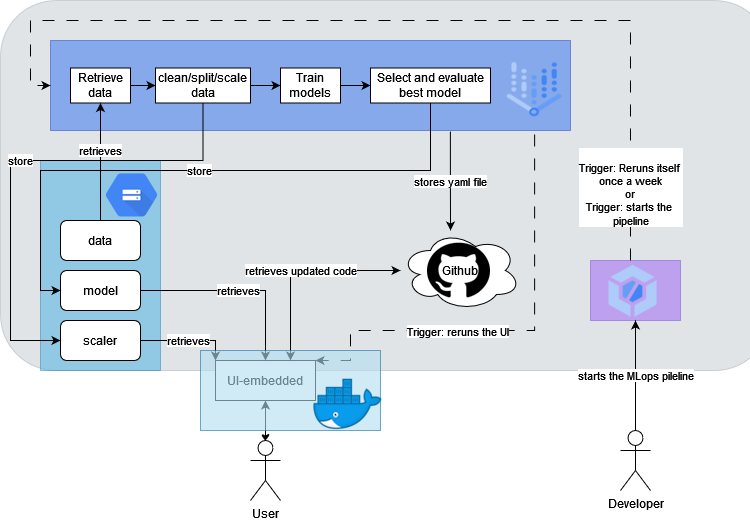

# Red Wine Quality: MLOps on Google Cloud

An end-to-end MLOps setup around a deliberately simple wine-quality classifier: a Vertex AI training pipeline, a containerised Flask app on Cloud Run, and Cloud Build CI/CD that retrains and redeploys without manual steps.

Group project for Data Engineering at JADS (October 2024).

*Figure 1 from the [project report](docs/Report_Assignment1_Group3.pdf).*

## How it works

1. **Training pipeline (Vertex AI).** Downloads the red wine data from a Cloud Storage bucket, splits and scales it, trains KNN, Random Forest and SVM, picks the highest-accuracy model, checks it on a held-out set against an accuracy threshold, and uploads approved models to a bucket. The pipeline is compiled to YAML, so it is versioned and reproducible.
2. **Serving.** A Flask app (UI and prediction in one container) loads the model and scaler from the bucket and labels a wine good, medium or bad.
3. **CI/CD (Cloud Build).** One recipe builds the pipeline-executor image, one runs the pipeline (weekly via Cloud Scheduler, or on demand), and one builds the app image, pushes it to Artifact Registry and deploys it to Cloud Run. The pipeline fires the deploy trigger when a new model is uploaded.

## Repository map

| Path | What it is |
|---|---|
| `pipeline/PipelineComponents.ipynb` | Pipeline components and definition, compiled to `red_wine_quality_pipeline.yaml` |
| `pipeline/builder_tool/` | Small image that submits the compiled pipeline to Vertex AI |
| `pipeline/*cloudbuild.json`, `pipeline/cloud_build_*.json` | Cloud Build recipes: build the executor, run the pipeline, build and deploy the app |
| `pipeline/parameters.json` | Pipeline parameters |
| `app.py`, `Winepredictor.py`, `templates/` | Flask serving app |
| `Dockerfile`, `requirements_*.txt` | App container |
| `data/raw/` | Wine quality dataset |
| `docs/` | Project report and architecture figure |

## Configuration

Project ID, bucket names and trigger ID are placeholders (`your-gcp-project-id`, `your-data-bucket`, and so on) in `pipeline/parameters.json`, `pipeline/PipelineComponents.ipynb` and `Winepredictor.py`. The Cloud Build recipes take their values from substitution variables (`_LOCATION`, `_REPOSITORY`, `_MODEL_REPO`, ...).

## Scope

Built to demonstrate the MLOps infrastructure, so the ML itself is kept simple: default scikit-learn models, no tuning, one embedded Flask app. Not covered: automated tests, drift monitoring, model versioning. The schedule and triggers were configured in the Google Cloud console rather than as code.

## Credits

Group 3: Andrea Ciavatti, Csanád Végh, Leopold Paris, Niels Boonstra, Vladimir Popov. Individual contributions are described in the report, which also refers to a decision tree where the final pipeline trains a Random Forest.

The Flask app and Cloud Build recipes are adapted from the course lab material. Data: P. Cortez et al., *Modeling wine preferences by data mining from physicochemical properties*, Decision Support Systems, 2009 (UCI Machine Learning Repository).
